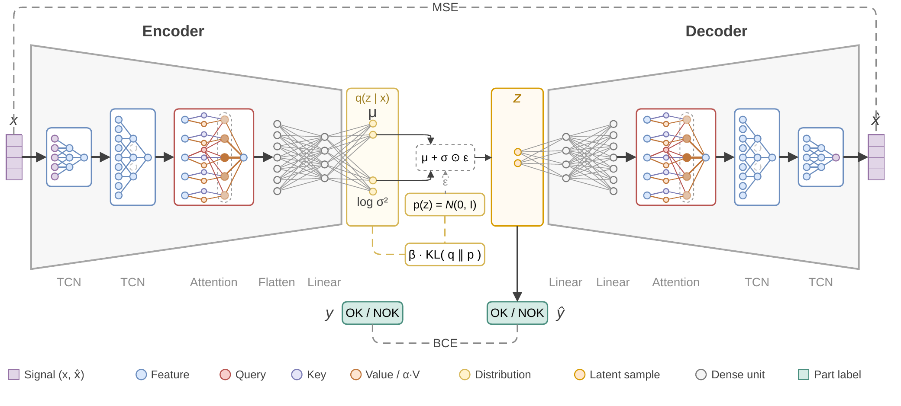

# MouldIt

MouldIt is a temporal deep learning model for time series. Think of your data as a table where each row
is one recording, such as one injection moulding production cycle, and each column is a moment in time,
with one such table per sensor. MouldIt is built for data shaped like this, so it has the potential to
work beyond injection moulding, though we have only tested it on such data.

From each recording, MouldIt learns a short summary. With it, one model tells good parts from the
different kinds of faulty ones, flags recordings unlike anything it has seen, and rebuilds the signal.

<p align="center">
  
  <br><em>The MouldIt model. The encoder turns a recording x into a 32-number summary z; from z, a
  classifier names the part as OK or one of the faults, and the decoder rebuilds the recording.</em>
</p>

How much data does such a model need to beat the classical tools? Starting from one real injection
moulding cycle, we generate training sets of 50 to 16,000 cycles and compare MouldIt with nearest
neighbours, logistic regression, random forests, PCA, and random forests with the PCA unknown flag, the
strongest classical rival at sorting parts.

<p align="center">
  
  <br><em>(a) One real cycle of a part becomes (b) synthetic training sets of 50 to 16,000 cycles.
  (c) MouldIt is compared with classical methods and (d) MouldIt leads from 4,000 cycles with pressure alone and
  from 2,000 with all sensors. (e) It flags unknown faults by its summary, its reconstruction, or both, and
  (f) at 16,000 cycles it sorts parts with the fewest errors.</em>
</p>

All cycles but one are process-informed synthetic data, and so are the faults. Whether the results hold on
a real production line still needs to be tested on real production data.

## Getting started

```bash
python -m venv .venv && source .venv/bin/activate
pip install -r requirements.txt
pip install -e .
python -m mouldit_benchmark.datasets.download_reference_cycle
```

The last step downloads the real cycle that every dataset here is built from.

## Reproducing the results

```bash
python scripts/run_benchmark.py              # trains and evaluates every method; takes days on one GPU
bash scripts/reproduce_paper_results.sh      # draws the paper's figures and tables into results/paper/
```

The benchmark can be stopped and restarted at any time and picks up where it left off.

## Data

The real cycle comes from the FORinFPRO-HIMD dataset by Rohan Kini and Lukas Schweizer
([doi:10.5281/zenodo.20744054](https://doi.org/10.5281/zenodo.20744054)), shared under CC BY 4.0.

## Paper

MouldIt and these experiments are described in
[MouldIt: Data Efficiency of Multi-Task Temporal Representation Learning in Injection Moulding](https://arxiv.org/abs/2611.13646).
If you use this work, please cite:

```bibtex
@misc{ayad2026mouldit,
  author        = {Ayad, Abdullah},
  title         = {{MouldIt}: Data Efficiency of Multi-Task Temporal Representation Learning in Injection Moulding},
  year          = {2026},
  eprint        = {2611.13646},
  archivePrefix = {arXiv},
  primaryClass  = {cs.LG},
  url           = {https://arxiv.org/abs/2611.13646}
}
```

If you use the data, please also cite the dataset:

```bibtex
@misc{kini2026dataset,
  author       = {Kini, Rohan and Schweizer, Lukas},
  title        = {{FORinFPRO-HIMD}: Multimodal Sensor Dataset for Hybrid Injection Molding of Continuous
                  Fiber-Reinforced Polypropylene Composites},
  howpublished = {Zenodo},
  year         = {2026},
  doi          = {10.5281/zenodo.20744054}
}
```

## License

The code is under the [PolyForm Noncommercial License 1.0.0](LICENSE). You may use, change and share it for
research, teaching, personal projects and any other noncommercial purpose. Commercial use needs a separate
licence from the author; please get in touch.

The reference cycle is from FORinFPRO-HIMD and is under CC BY 4.0.
